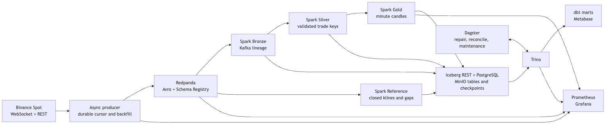

# Streaming Lakehouse

A local portfolio project for collecting public Binance Spot trades, recovering gaps, and reconciling one-minute candles against Binance. Redpanda buffers the feed, Spark writes the Iceberg tables, and Trino serves dbt marts over MinIO.



## Run locally

Use Docker Compose and [uv](https://docs.astral.sh/uv/getting-started/installation/). On a 24 GB machine with Docker Desktop, allocate about 14 GB to the Docker VM for the full stack. Initial builds download Spark dependencies and compile the pinned MinIO community release.

```sh
uv python install
make sync
make up
make topics
make start-streams
make dashboards
```

Use `make up-lite && make start-streams` to run ingestion, the lakehouse, and basic Prometheus/Grafana monitoring on a smaller Docker VM. The query and BI services start with `make up`. Set local overrides in `.env` using [.env.example](.env.example). All published service ports bind to loopback.

| Interface | Local address |
|---|---|
| Trino | http://127.0.0.1:18080 |
| Grafana | http://127.0.0.1:3000 |
| Dagster | http://127.0.0.1:3001 |
| Metabase | http://127.0.0.1:3002 |
| Prometheus | http://127.0.0.1:9090 |

`make dashboards` builds the dbt marts, provisions the Metabase dashboards, and runs their queries. It stores the generated local admin password in `data/metabase-password` with owner-only permissions. See [sample SQL](docs/queries.sql) and [architecture](docs/ARCHITECTURE.md).

```sh
make recon
make invariants
make lint test
make down
```

`make down` retains volumes. `make reset CONFIRM=delete-local-data` removes this Compose project's data volumes.

## Recovery and validation

Silver uses `(symbol, agg_trade_id)` as its key. The producer acknowledges its durable cursor only after Kafka acknowledges delivery. Reconnects can replay a batch and backfill publishes recovered IDs again when needed. Silver's insert-only merge handles both. Bronze keeps Kafka offsets and the original bytes for audit.

Gold updates live with a 30-second event-time watermark. Closed windows affected by a completed backfill are rebuilt from Silver and reconciled again. Reconciliation records mismatches, missing inputs, and empty Binance candles separately and excludes each symbol's first, potentially partial minute.

```sh
make demo
make chaos-spark-kill chaos-broker-restart chaos-minio-restart
make chaos-poison chaos-schema-v2 chaos-producer-cut chaos-late-data
make loadtest
make demo-down
```

The demo uses independent ports, broker, storage, and checkpoints. Running it alongside the full live stack consumes additional memory. [Failure modes](docs/FAILURE_MODES.md) · [Chaos results](docs/CHAOS_RESULTS.md) · [Benchmarks](docs/BENCHMARKS.md)

Public market data only. This project does not provide financial advice.
