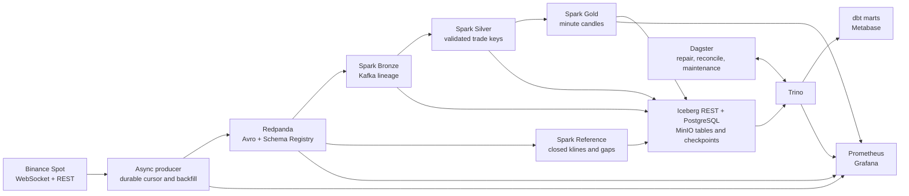

# Architecture

## Write and replay boundaries

- Kafka idempotence prevents duplicate writes from broker retries within the producer session. An acknowledgement can arrive just before the process crashes. The local SQLite WAL transaction either saves both the cursor and the detected gap or saves neither. On restart the earlier cursor can cause replay, which Silver deduplicates.
- Bronze appends through Iceberg's streaming sink with Kafka source offsets in a dedicated checkpoint. The five-byte Confluent framing is retained in the raw payload and removed for Avro decoding. The v2 writer appends an optional field, so the v1 projection reads the unchanged prefix. A breaking schema requires a coordinated consumer upgrade.
- Silver chooses one valid input per trade key per batch before its insert-only merge. Replay of invalid input can emit another Kafka DLQ notification. The durable DQ table deduplicates those notifications by source topic, partition, and offset.
- Gold uses Spark event time and orders ties by aggregate ID. The batch repair waits for complete Silver coverage and an official closed kline, then updates the affected minute from Silver. The repaired flag protects the row from streaming updates, and a concurrent Iceberg commit conflict is retried by Dagster. Spot OHLC and volume remain decimal throughout. Quote turnover and VWAP use fixed eight-decimal Spot inputs so Spark and Trino can calculate the products without exceeding their maximum decimal precision.
- The long-lived Spark jobs own their checkpoints. Dagster runs bounded jobs and can retry a repair or maintenance operation independently. PostgreSQL supports concurrent REST catalog commits. Its three databases keep catalog, Dagster, and Metabase metadata separate.
- Iceberg snapshots make a table commit atomic. Failed writes can leave unreferenced files, which maintenance removes after the retention period. Streaming input tables receive appends and data-preserving compaction only.

## Local settings

Spark uses two local worker threads, four shuffle partitions, a 10-second trigger, and a 30,000-offset cap per Kafka micro-batch. This limits concurrent memory use and gives micro-batches enough work to amortize scheduling. UTC aligns trade times, candles, and reference klines. Case-sensitive Avro decoding distinguishes Binance's `e` event type and `E` event timestamp. Each Spark query has its own S3A checkpoint under `s3://lakehouse/checkpoints`. Iceberg data files use S3FileIO under `s3://lakehouse/warehouse`.

## Scope of verification

Continuity is measured between observed IDs. A newly configured symbol has no baseline before its first event. Recovery depends on the provider retaining the missing history and on Kafka/Iceberg retention. A single local broker and object store model process recovery, with no protection from losing their storage volumes. Source gaps, unmatched reference windows, and expired checkpoints require investigation.
